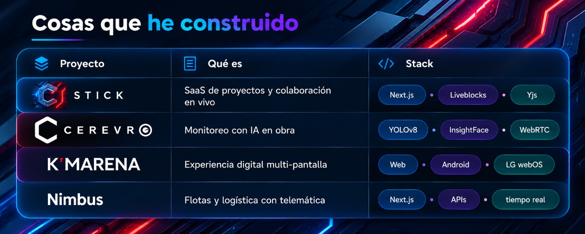

  <a href="#es">🇲🇽 Español</a> · <a href="#en">🇺🇸 English</a>

# Hola, soy Jorge Alfredo Jones 👋

### Tech Lead · Software Architect · Indie Game Developer

Lidero equipos de desarrollo y construyo productos digitales, desde el diseño de su arquitectura hasta su puesta en producción.

Actualmente trabajo en **[Black Sheep Labs](https://blck-sheep.com)**, donde participo en el desarrollo de plataformas empresariales, soluciones SaaS y sistemas de integración.

También soy fundador de **[Ni Tan Tan Studios](https://github.com/Ni-Tan-Tan-Studios)**, un estudio independiente de videojuegos nacido en México.

**Me gusta convertir ideas complejas en productos funcionales, escalables y fáciles de utilizar.**

  
  
  
  

---

## 🚀 Lo que hago

- **Liderazgo técnico:** coordinación de equipos, revisión de soluciones y toma de decisiones de arquitectura.
- **Desarrollo full-stack:** aplicaciones web, plataformas SaaS, APIs y sistemas empresariales.
- **Arquitectura e infraestructura:** despliegues, integración de servicios y operación de aplicaciones.
- **Sistemas en tiempo real:** comunicación mediante WebSockets, eventos y servicios conectados.
- **Visión artificial:** soluciones de procesamiento de video y análisis mediante Python.
- **Desarrollo de videojuegos:** diseño e implementación de experiencias interactivas con Godot.

---

## 🏢 Experiencia y productos

### Black Sheep Labs

**Tech Lead · Arquitectura y desarrollo de software**

Trabajo en soluciones tecnológicas para distintas necesidades empresariales, combinando desarrollo de producto, arquitectura e integración de servicios.

Entre los proyectos y plataformas en los que participo se encuentran:

| Producto | Área |
|---|---|
| **Stick** | Gestión de proyectos, tareas y procesos empresariales |
| **COSMOS POS** | Punto de venta y operación comercial |
| **Nimbus** | Soluciones para operaciones logísticas |
| **K´marena** | Señalización digital |

### Experiencia técnica adicional

He trabajado con soluciones de monitoreo, procesamiento de video, integración de cámaras y visión artificial, además de aplicaciones web y móviles.

  

---

## 🎮 Mi estudio de videojuegos

### Ni Tan Tan Studios

**No tan serios. Muy buenos momentos.**

Estudio independiente de desarrollo de videojuegos creado en México.

Exploramos ideas, mecánicas e historias para desarrollar experiencias con identidad propia.

[**Conoce Ni Tan Tan Studios →**](https://github.com/Ni-Tan-Tan-Studios)

### Juegos en desarrollo

**⚡ Number Rush**

Juego móvil de números, velocidad y competencia, desarrollado con Godot para Android.

**📬 Última Recolección**

Videojuego narrativo ambientado en una oficina de correos, desarrollado con Godot 4.

> Los repositorios de desarrollo de los juegos son privados. Su presentación pública está disponible en el perfil del estudio.

---

## 🛠️ Tecnologías

**Frontend**

**Backend y bases de datos**

**Infraestructura e integraciones**

**Videojuegos y visión artificial**

---

## 🎓 Formación

- **Ingeniería en Tecnologías de la Información y Comunicación**
- Formación y experiencia en desarrollo de videojuegos y aplicaciones móviles
- Aprendizaje continuo en arquitectura de software, infraestructura y nuevas tecnologías

---

## 📊 GitHub

  
<b>Ver estadísticas de GitHub</b>

   

  

  

---

## 📬 Contacto

¿Tienes una idea, un proyecto o una oportunidad de colaboración?

**Portafolio:** https://alfredojones.dev

**LinkedIn:** https://www.linkedin.com/in/jorgeajones/

**Correo:** hola@alfredojones.dev

**Estudio:** https://github.com/Ni-Tan-Tan-Studios

---

# Hey, I'm Jorge Alfredo Jones 👋

### Tech Lead · Software Architect · Indie Game Developer

I lead development teams and build digital products, from software architecture to production deployment.

I currently work at **[Black Sheep Labs](https://blck-sheep.com)**, contributing to enterprise platforms, SaaS products, and software integrations.

I'm also the founder of **[Ni Tan Tan Studios](https://github.com/Ni-Tan-Tan-Studios)**, an independent game development studio based in Mexico.

**I enjoy turning complex ideas into functional, scalable, and intuitive products.**

## 🚀 What I Do

- **Technical leadership:** team coordination, architectural decisions, and solution design.
- **Full-stack development:** web applications, SaaS platforms, APIs, and enterprise systems.
- **Software architecture:** infrastructure, deployment, and service integration.
- **Real-time systems:** WebSockets and event-driven communication.
- **Computer vision:** video processing and Python-based solutions.
- **Game development:** interactive experiences built with Godot.

## 🏢 Professional Work

At **Black Sheep Labs**, I contribute to enterprise software products including:

- **Stick:** project, task, and business process management.
- **COSMOS POS:** point-of-sale and commercial operations.
- **Nimbus:** logistics operations.
- **Camariana:** digital signage.
- **Black Sheep Suite:** enterprise software solutions.

## 🎮 Indie Game Development

### Ni Tan Tan Studios

**Not too serious. Seriously fun.**

An independent game development studio from Mexico, focused on creating original gaming experiences.

**Current projects:**

- **Number Rush:** a fast-paced mobile number game for Android.
- **Última Recolección:** a narrative game set in a post office.

[**Explore Ni Tan Tan Studios →**](https://github.com/Ni-Tan-Tan-Studios)

## 🛠️ Main Technologies

**Frontend:** Next.js, React, TypeScript, JavaScript

**Backend:** Node.js, PHP, Python, REST APIs

**Databases:** SQL Server, PostgreSQL, MySQL

**Infrastructure:** Windows Server, IIS, Cloudflare, PM2

**Game Development:** Godot, GDScript

## 📬 Let's Connect

**Portfolio:** https://alfredojones.dev

**LinkedIn:** https://www.linkedin.com/in/jorgeajones/

**Email:** hola@alfredojones.dev

**Game Studio:** https://github.com/Ni-Tan-Tan-Studios

---

**Building software. Leading teams. Creating games.**

*From Mexico, with curiosity and a passion for technology.*

